# VendaHub

Gestão comercial para pequenas lojas: produtos e estoque, clientes, vendas e um painel de indicadores — com PostgreSQL (Supabase) como fonte da verdade e Redis como cache dos indicadores.

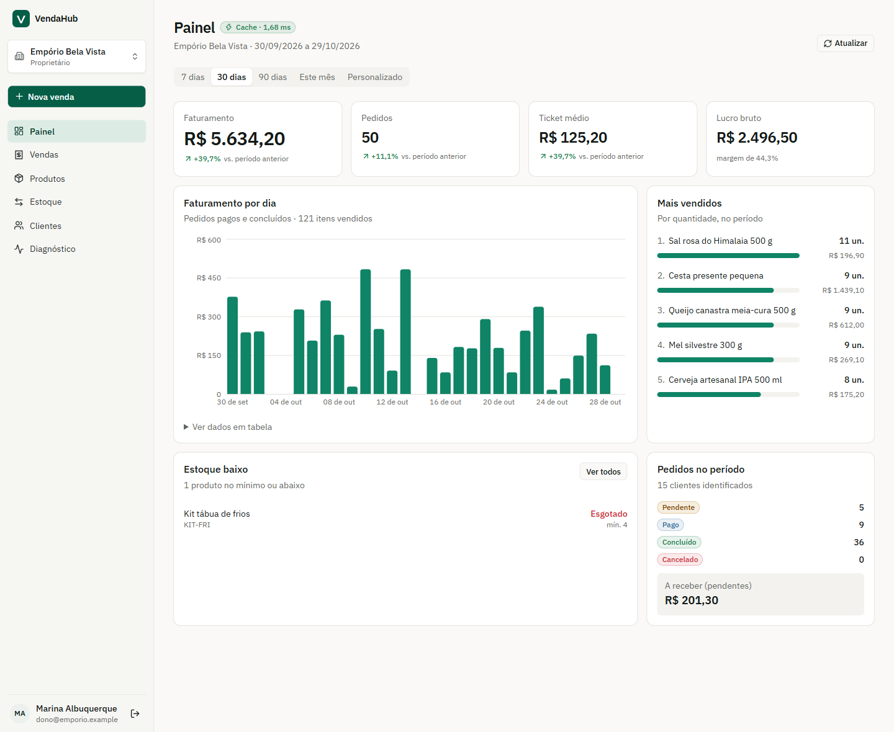

## Sumário

- [O problema](#o-problema)
- [Funcionalidades](#funcionalidades)
- [Stack e arquitetura](#stack-e-arquitetura)
- [Estrutura de pastas](#estrutura-de-pastas)
- [Modelo de dados](#modelo-de-dados)
- [Regras de negócio dos pedidos](#regras-de-negócio-dos-pedidos)
- [Segurança](#segurança)
- [Cache com Redis](#cache-com-redis)
- [Como executar](#como-executar)
- [Variáveis de ambiente](#variáveis-de-ambiente)
- [Testes](#testes)
- [Capturas de tela](#capturas-de-tela)
- [Limitações conhecidas](#limitações-conhecidas)
- [Documentação da API](docs/API.md)

## O problema

Pequenos comércios costumam controlar vendas em planilha ou caderno e o estoque "de cabeça". O resultado é produto em falta sem aviso, venda registrada duas vezes, preço errado no pedido e nenhuma visão de quanto a loja faturou no mês.

O VendaHub centraliza a operação comercial:

- cada venda baixa o estoque na mesma transação que registra o pedido;
- o preço e o total vêm sempre do banco, nunca do navegador;
- o painel mostra faturamento, ticket médio, mais vendidos e reposição necessária, calculados a partir dos dados reais.

## Funcionalidades

| Área | O que faz |
|---|---|
| **Painel** | Faturamento, pedidos, ticket médio e lucro bruto com comparação ao período anterior; faturamento diário (gráfico + tabela); mais vendidos; estoque baixo; pedidos por status e valor a receber. Filtros de 7, 30 e 90 dias, mês atual ou datas livres. |
| **Produtos** | Cadastro com SKU, descrição, preço, custo, estoque inicial e mínimo; busca, filtros (ativos, estoque baixo, arquivados), ordenação e paginação; edição; arquivamento (exclusão lógica) e restauração. |
| **Estoque** | Entradas por compra e ajustes manuais com motivo obrigatório; histórico completo de movimentações (saldo após cada uma, origem e responsável); bloqueio de saldo negativo. |
| **Clientes** | Cadastro mínimo (nome, e-mail, telefone, observações); busca; total comprado, nº de pedidos, ticket médio, última compra, produtos preferidos e pedidos recentes. |
| **Vendas** | Pedido com vários itens, cliente opcional e desconto; registro como pago ou pendente; avanço de status; cancelamento com devolução ao estoque; filtros por status, período, número e cliente. |
| **Diagnóstico** | Estado e latência do Supabase e do Redis; hits, misses, taxa de acerto e latência média/p95 de cada tipo de resposta; eventos de invalidação; chaves da empresa com TTL; latência por rota da API; erros recentes sem dados sensíveis; roteiro guiado MISS → HIT → venda → MISS. |
| **Contas** | Login e cadastro pelo Supabase Auth; criação da primeira empresa; várias empresas por usuário com troca rápida; papéis proprietário, gerente e vendedor. |

## Stack e arquitetura

| Camada | Tecnologia |
|---|---|
| Front-end | React 19, TypeScript, Vite, Tailwind CSS 4, componentes Radix/shadcn, TanStack Query, React Router, Recharts |
| API | Node.js 22+, Fastify 5, Zod, supabase-js, ioredis |
| Banco e autenticação | Supabase (PostgreSQL 17 + Auth), Row Level Security, funções PL/pgSQL |
| Cache | Redis 7+ (Docker ou Memurai no Windows) |
| Testes | Vitest (unitários e de integração contra Supabase e Redis reais) |

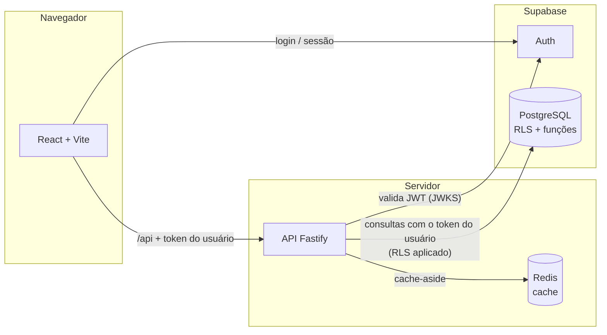

**Por que uma API própria, se o Supabase já expõe o banco?** Ela concentra o que não pode ficar no navegador:

- validação de entrada;
- conferência de papel e empresa;
- o cache no Redis e a invalidação depois de cada alteração;
- as métricas de diagnóstico.

A API não usa a chave administrativa. Cada consulta sai com o token do próprio usuário, então o RLS do PostgreSQL continua sendo a última barreira.

**Camadas da API** (`apps/api/src`):

| Pasta | Papel |
|---|---|
| `routes/` | Rotas HTTP |
| `schemas/` | Validação de entrada com Zod |
| `services/` | Regras e invalidação de cache |
| `repositories/` | Acesso a dados com supabase-js |
| `cache/` | Cliente Redis, chaves, métricas e cache-aside |
| `plugins/` | Autenticação e contexto da empresa |
| `config/` | Variáveis de ambiente validadas |
| `observability/` | Latências e erros |

## Estrutura de pastas

```
VendaHub/
├── apps/
│   ├── api/                 # API Fastify (TypeScript)
│   │   ├── src/             # código da API (camadas acima)
│   │   ├── scripts/         # check-env.ts e seed-demo.ts
│   │   └── tests/           # unit/ (dublês) e integration/ (Supabase + Redis reais)
│   └── web/                 # front-end React
│       └── src/             # pages/, components/, hooks/, providers/, lib/
├── supabase/
│   ├── config.toml          # configuração do projeto (Auth, portas do ambiente local)
│   └── migrations/          # migrações SQL versionadas (esquema, RLS, funções)
├── docs/                    # API.md e capturas de tela
├── docker-compose.yml       # Redis
├── .env.example             # modelo de configuração (sem credenciais)
└── package.json             # workspaces e scripts
```

## Modelo de dados

```mermaid
erDiagram
  companies ||--o{ company_members : "tem"
  profiles ||--o{ company_members : "participa"
  companies ||--o{ products : ""
  companies ||--o{ customers : ""
  companies ||--o{ orders : ""
  customers |o--o{ orders : "compra"
  orders ||--|{ order_items : "contém"
  products ||--o{ order_items : "vendido em"
  products ||--o{ stock_movements : "movimenta"
  orders |o--o{ stock_movements : "origina"

  companies { uuid id PK; text name; int order_seq }
  profiles { uuid id PK "= auth.users.id"; text full_name }
  company_members { uuid company_id PK; uuid user_id PK; member_role role }
  products { uuid id PK; text sku; numeric price; numeric cost; int stock_quantity; int min_stock; bool is_low_stock; timestamptz archived_at }
  customers { uuid id PK; text name; text email; text phone; timestamptz archived_at }
  orders { uuid id PK; int number; order_status status; numeric subtotal; numeric discount; numeric total; uuid idempotency_key }
  order_items { uuid id PK; int quantity; numeric unit_price; numeric unit_cost; numeric line_total }
  stock_movements { bigint id PK; movement_type type; int quantity; int balance_after; text reason }
```

Decisões principais:

- **Dinheiro em `numeric(12,2)`** e quantidades em inteiros. `line_total` é coluna gerada, e `total = subtotal − desconto` é garantido por `CHECK`.
- **Multiempresa no banco.** Toda tabela de negócio tem `company_id`, e as chaves estrangeiras compostas `(id, company_id)` impedem que um pedido aponte para produto ou cliente de outra empresa.
- **Preço histórico.** O item guarda nome, SKU, preço e custo do momento da venda; alterar o cadastro depois não muda pedidos antigos.
- **Auditoria de estoque.** `stock_movements` só recebe inserções, registra o saldo após cada movimento e tem índice único `(order_id, product_id, type)`, que impede baixa ou devolução duplicada.
- **Exclusão lógica** (`archived_at`) para produtos e clientes já referenciados em vendas.
- **Índices** para busca por nome (trigram), listagens por empresa e data, estoque baixo (índice parcial) e pedidos por status e cliente.

As migrações ficam em [`supabase/migrations`](supabase/migrations) e são aplicadas em ordem pelo Supabase CLI.

## Regras de negócio dos pedidos

| Status | Significado | Estoque |
|---|---|---|
| `pending` (Pendente) | Venda registrada, pagamento a confirmar | Já baixado (reservado) |
| `paid` (Pago) | Pagamento confirmado | Baixado |
| `completed` (Concluído) | Entregue; estado final | Baixado |
| `canceled` (Cancelado) | Estado final | Devolvido |

Transições permitidas: pendente → pago → concluído e pendente → concluído. Cancelamento só em pendente ou pago, por proprietário ou gerente.

A criação acontece na função `create_order`, numa única transação:

1. Valida itens, desconto e cliente.
2. Trava a linha da empresa (numeração sequencial e idempotência sem corrida).
3. Trava cada produto (`FOR UPDATE`, em ordem de id para evitar deadlock), confere o saldo e lê o preço do banco.
4. Grava pedido, itens, baixa de estoque e movimentações.

Qualquer falha desfaz tudo. Duas vendas simultâneas do último item não passam: a segunda espera a primeira terminar e encontra o saldo zerado.

**Idempotência.** O front gera uma chave `Idempotency-Key` por tentativa de venda. Repetir a requisição (duplo clique ou nova tentativa após falha de rede) devolve o mesmo pedido, com `replayed: true`, sem baixar o estoque de novo.

**Cancelamento.** Trava o pedido; o segundo cancelamento simultâneo recebe `ORDER_ALREADY_CANCELED`, e o estoque volta uma única vez.

## Segurança

**Autenticação.** Supabase Auth (e-mail e senha). A API valida a assinatura e a validade do JWT pelo JWKS do projeto (`auth.getClaims`) e recusa tokens que não sejam de usuário autenticado.

**Empresa ativa.** O cliente envia `X-Company-Id`, mas a API só aceita o valor depois de confirmar no banco que o usuário é membro dessa empresa e tem o papel exigido.

**Row Level Security** em todas as tabelas:

| Recurso | Proprietário | Gerente | Vendedor |
|---|:-:|:-:|:-:|
| Ver dados da empresa | ✔ | ✔ | ✔ |
| Cadastrar e editar produtos, movimentar estoque | ✔ | ✔ | — |
| Cadastrar e editar clientes | ✔ | ✔ | ✔ |
| Criar venda, confirmar pagamento, concluir | ✔ | ✔ | ✔ |
| Cancelar venda | ✔ | ✔ | — |
| Editar dados da empresa | ✔ | — | — |

Defesa em profundidade:

- `anon` não acessa nenhuma tabela.
- `orders`, `order_items` e `stock_movements` são somente leitura para usuários; a escrita acontece só pelas funções transacionais, que conferem papel e saldo.
- `stock_quantity` não aceita `UPDATE` direto (privilégio por coluna).
- As funções `SECURITY DEFINER` usam `search_path` vazio e checam associação explicitamente. As de consulta (`dashboard_summary`, `customer_insights`) são `SECURITY INVOKER`, então o RLS também vale nelas.

Chaves e segredos:

- O front recebe **apenas** `SUPABASE_URL` e a chave pública.
- O Vite e a API recusam iniciar se a chave secreta for colocada no lugar da pública.
- A chave secreta fica no servidor e é usada só pelo seed e pelos testes de integração.

Na API:

- **Helmet:** cabeçalhos de segurança.
- **CORS:** restrito às origens configuradas.
- **Rate limit:** 300 requisições por minuto por IP.
- **Logs:** o cabeçalho `Authorization` é ocultado.
- **Erros:** o cliente recebe mensagens amigáveis, sem SQL nem stack trace.

O build de produção inclui uma Content Security Policy.

## Cache com Redis

O painel agrega pedidos, itens e produtos de um período inteiro, e é a tela mais acessada. O catálogo de produtos é consultado a cada nova venda. Os dois usam **cache-aside**.

| | Dashboard | Catálogo |
|---|---|---|
| Chave | `vendahub:v1:co:<empresa>:dashboard:from=…&to=…&tz=…` | `vendahub:v1:co:<empresa>:catalog:<filtros>` |
| TTL padrão | 60 s (`CACHE_TTL_DASHBOARD_SECONDS`) | 120 s (`CACHE_TTL_CATALOG_SECONDS`) |
| Invalidado por | venda, mudança de status, cancelamento, produto, estoque | venda, cancelamento, produto, estoque |

**Leitura.** Um único `MULTI` traz o valor, o TTL e o contador de geração da empresa:

- **HIT:** o valor existe e é da geração atual; a resposta sai do Redis.
- **MISS:** o valor não existe, expirou ou é de geração antiga. A API consulta o PostgreSQL e grava o resultado com TTL, marcado com a geração lida antes da consulta.
- **BYPASS:** o Redis está fora. A API responde direto do PostgreSQL e avisa na resposta; o usuário não vê erro.

**Invalidação.** Só depois que o banco confirma a alteração, a API faz `INCR` no contador de geração da empresa (`…:<namespace>:gen`). É O(1), não varre chaves e invalida todas as combinações de filtro de uma vez.

Um cálculo que estava em andamento durante a alteração grava com a geração antiga e é descartado na próxima leitura (evento `DESCARTADO` no diagnóstico). Um resultado velho nunca é servido como atual.

**Isolamento.** A empresa faz parte de toda chave, e o papel do usuário não entra porque todos os papéis veem os mesmos indicadores e o mesmo catálogo. A associação à empresa é conferida antes de qualquer acesso ao cache.

**Falhas e recuperação.**

| Situação | Comportamento |
|---|---|
| Redis cai na leitura | BYPASS; cliente sem fila offline e tempo limite de 1 s por comando, então nada trava |
| Redis cai entre o commit e a invalidação | A empresa fica pendente; as leituras dela fazem BYPASS e a invalidação é refeita automaticamente na reconexão |
| A API reinicia nesse intervalo | O TTL limita a defasagem a 60 s (dashboard) ou 120 s (catálogo) |
| Várias instâncias da API | A pendência fica na memória de cada instância; vale o limite do TTL acima |

O PostgreSQL continua sendo a fonte da verdade; o Redis guarda apenas cópias descartáveis. Cada resposta em cache informa estratégia, horário do cálculo, TTL restante e tempos medidos (selo "Cache · 1,68 ms" ao lado do título).

## Como executar

### Pré-requisitos

- **Node.js 22.12 ou superior** (testado com 24.14) e npm.
- **Redis 7+**, com uma das opções:
  - Docker: `npm run redis:up` (usa o `docker-compose.yml`);
  - Windows sem Docker: [Memurai](https://www.memurai.com/) (compatível com Redis) como serviço na porta 6379;
  - Linux ou macOS: o pacote `redis-server`.
- **Acesso a um projeto Supabase.** Há dois caminhos:
  - receber o `.env` do projeto já configurado, por canal privado e nunca pelo GitHub;
  - criar um projeto próprio (passo 3 abaixo).
- **[Supabase CLI](https://supabase.com/docs/guides/cli)**, só para criar o próprio banco.

O app funciona sem Redis, em modo BYPASS: nada quebra, só não há cache.

### Passo a passo

```bash
# 1. Dependências
npm install

# 2. Configuração
cp .env.example .env        # no Windows (PowerShell): Copy-Item .env.example .env
# preencha o .env (veja a tabela de variáveis)

# 3. Banco (pule se recebeu o .env de um projeto já configurado)
supabase login
supabase link --project-ref <seu-project-ref>
supabase db push            # aplica as migrações de supabase/migrations
supabase config push        # aplica URLs de redirecionamento do Auth (config.toml)

# 4. Dados de demonstração (fictícios)
npm run db:seed

# 5. Redis
npm run redis:up            # ou inicie o Memurai/redis-server

# 6. Conferir tudo
npm run check:env

# 7. Desenvolvimento: API em :3333 e front em :5173
npm run dev
```

Abra http://localhost:5173 e entre com um usuário de demonstração. A senha de todos é o valor de `SEED_DEMO_PASSWORD` no `.env`.

| Empresa | Papel | E-mail |
|---|---|---|
| Empório Bela Vista | Proprietária | `dono@emporio.example` |
| Empório Bela Vista | Gerente | `gerente@emporio.example` |
| Empório Bela Vista | Vendedor | `vendas@emporio.example` |
| Papelaria Ponto Final | Proprietária | `dona@papelaria.example` |

A Papelaria existe para demonstrar o isolamento: entrando com a conta dela, nenhum dado do Empório aparece.

### Produção (um único processo)

```bash
npm run build     # compila API e front-end
npm start         # API em :3333 servindo também o front compilado
```

Abra http://localhost:3333. Rodando o build, `NODE_ENV` vale `production` por padrão (logs em JSON e front servido pela API).

### Scripts

| Script | O que faz |
|---|---|
| `npm run dev` | API (tsx watch) + front (Vite) com proxy de `/api` |
| `npm run build` / `npm start` | Build de produção / servidor de produção |
| `npm run check:env` | Verifica Node, `.env`, Supabase, migrações, Redis e build |
| `npm run db:seed` | Recria os dados de demonstração |
| `npm test` | Testes unitários (API e front) |
| `npm run test:integration` | Testes de integração contra o Supabase e o Redis do `.env` |
| `npm run lint` / `npm run typecheck` | ESLint e TypeScript |
| `npm run redis:up` / `npm run redis:down` | Sobe ou derruba o Redis via Docker |

## Variáveis de ambiente

Um único `.env` na raiz atende API e front-end. Modelo comentado: [`.env.example`](.env.example).

| Variável | Obrigatória | Uso |
|---|:-:|---|
| `SUPABASE_URL` | sim | URL do projeto (`https://<ref>.supabase.co`) |
| `SUPABASE_PUBLISHABLE_KEY` | sim | Chave pública; a única chave que chega ao navegador |
| `SUPABASE_SECRET_KEY` | seed/testes | Chave secreta; nunca vai para o front-end |
| `SUPABASE_PROJECT_REF`, `SUPABASE_DB_PASSWORD` | não | Usadas pelo Supabase CLI (`link`, `db push`) |
| `PORT` | não | Porta da API (padrão 3333) |
| `WEB_ORIGIN` | não | Origens liberadas no CORS |
| `APP_TIMEZONE` | não | Fuso dos filtros de período (padrão `America/Sao_Paulo`) |
| `REDIS_URL` | não | Padrão `redis://localhost:6379` |
| `REDIS_KEY_PREFIX` | não | Prefixo das chaves (padrão `vendahub`) |
| `CACHE_TTL_DASHBOARD_SECONDS` | não | TTL do dashboard (padrão 60) |
| `CACHE_TTL_CATALOG_SECONDS` | não | TTL do catálogo (padrão 120) |
| `SEED_DEMO_PASSWORD` | não | Senha dos usuários de demonstração |
| `LOG_LEVEL` | não | `info`, `debug`, `warn`… |

A configuração é validada na inicialização. Faltando algo, a API para com uma mensagem indicando exatamente o que corrigir.

## Testes

```bash
npm test                    # unitários
npm run test:integration    # integração: exige .env com Supabase e Redis acessíveis
```

Últimas execuções (29/10/2026, Windows 11, Node 24.14, Supabase sa-east-1, Redis 7.2 via Memurai):

| Suíte | Resultado |
|---|---|
| API — unitários (cache com dublê, rotas com dublês, schemas, erros, datas, configuração) | **44 aprovados** |
| Front-end — unitários (formatação, períodos) | **7 aprovados** |
| Integração — Supabase + Redis reais | **26 aprovados** |
| Typecheck, ESLint e build de produção (API e front) | sem erros |

O que a integração verifica, contra o banco e o Redis de verdade:

- **RLS:** isolamento entre empresas em leitura, inserção, pedidos e dashboard; vendedor sem permissão de cadastrar produto ou cancelar venda.
- **Integridade:** saldo de estoque e tabelas de pedido não aceitam escrita direta; o estoque inicial gera movimentação de auditoria.
- **Pedido com vários itens:** preços vindos do banco, subtotal, desconto e total corretos, itens e movimentações gravados.
- **Rollback:** um item sem estoque desfaz o pedido inteiro.
- **Concorrência:** 8 vendas simultâneas de um produto com 4 unidades resultam em exatamente 4 vendas e saldo zero.
- **Idempotência:** duas requisições paralelas com a mesma chave criam um único pedido.
- **Cancelamento duplo:** o estoque volta uma única vez.
- **Status:** transições válidas e inválidas; ajuste que deixaria o estoque negativo é recusado.
- **Cache (TTL e invalidação):** MISS grava com TTL, HIT não consulta a fonte, a chave expira, a invalidação incrementa a geração.
- **Redis indisponível:** BYPASS rápido, sem travar a requisição.
- **Fluxo completo pela API:** MISS → HIT → venda → MISS com o faturamento recalculado.

Os testes de integração criam empresas e usuários temporários e os removem ao final.

## Capturas de tela

Capturas reais do sistema com os dados de demonstração.

| | |
|---|---|
| 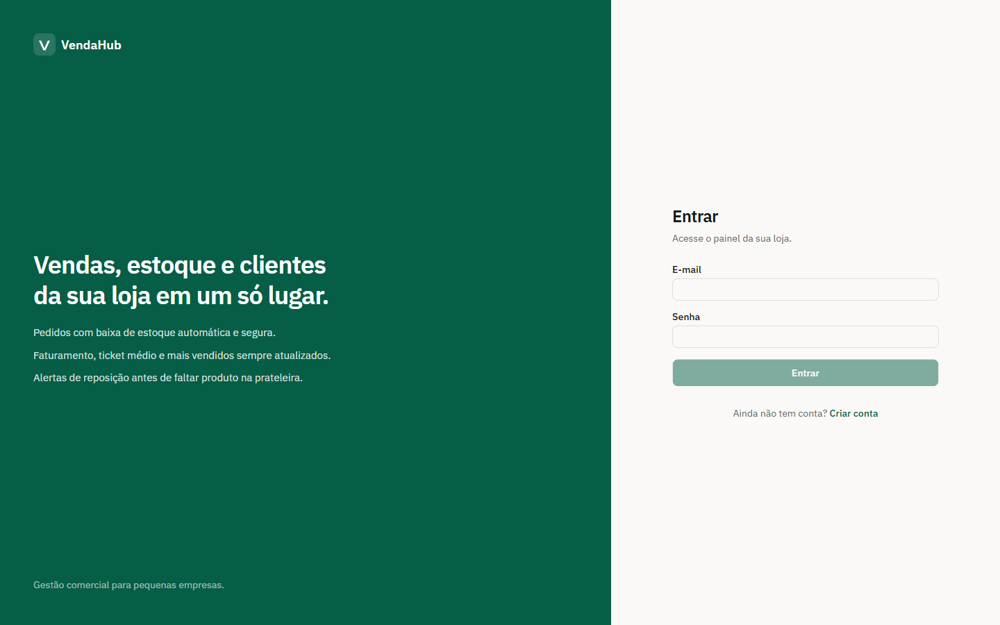 | 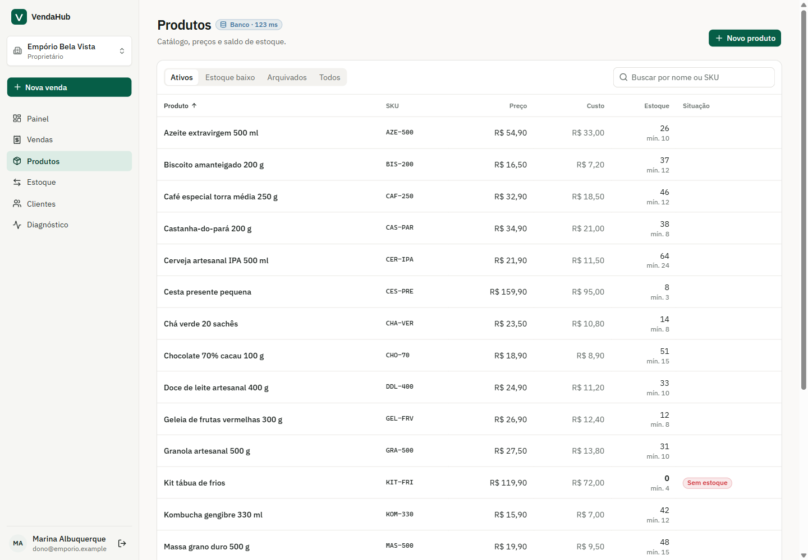 |
| 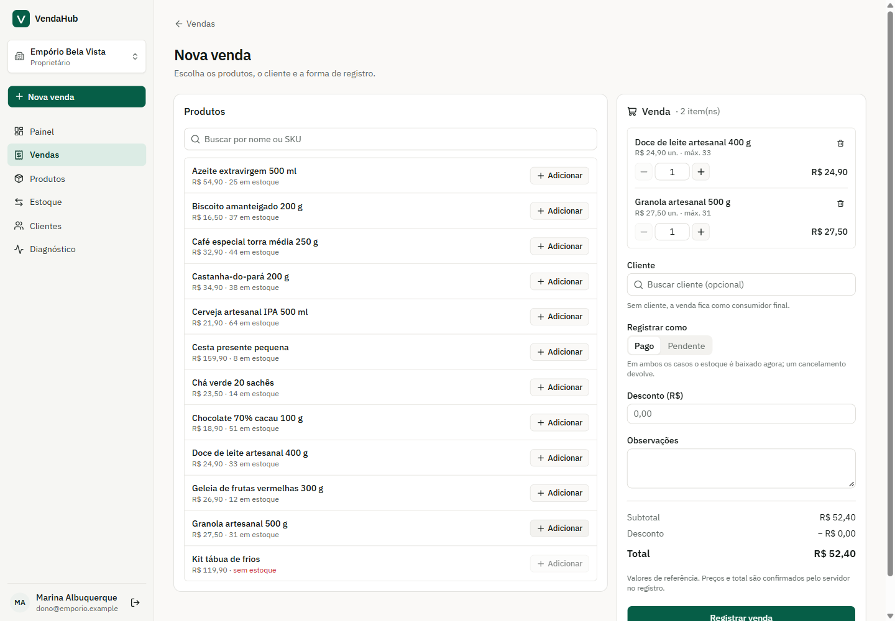 | 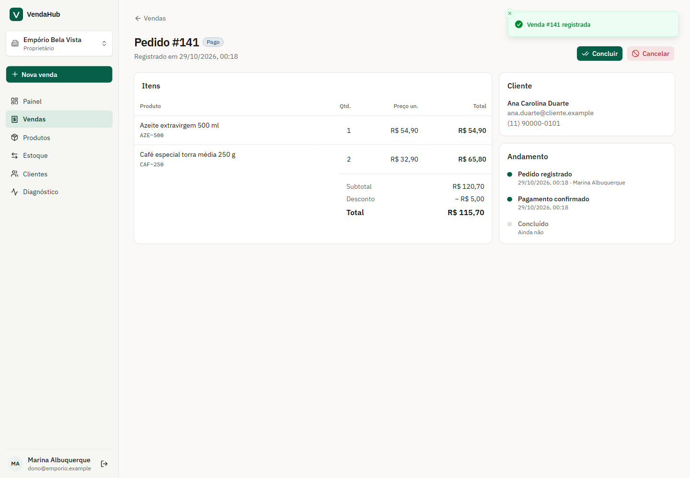 |
| 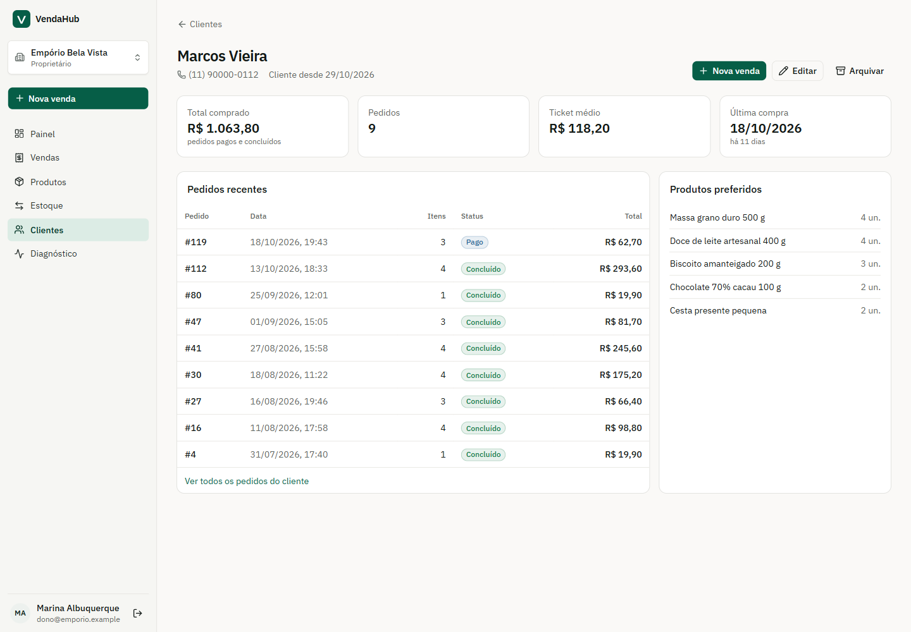 | 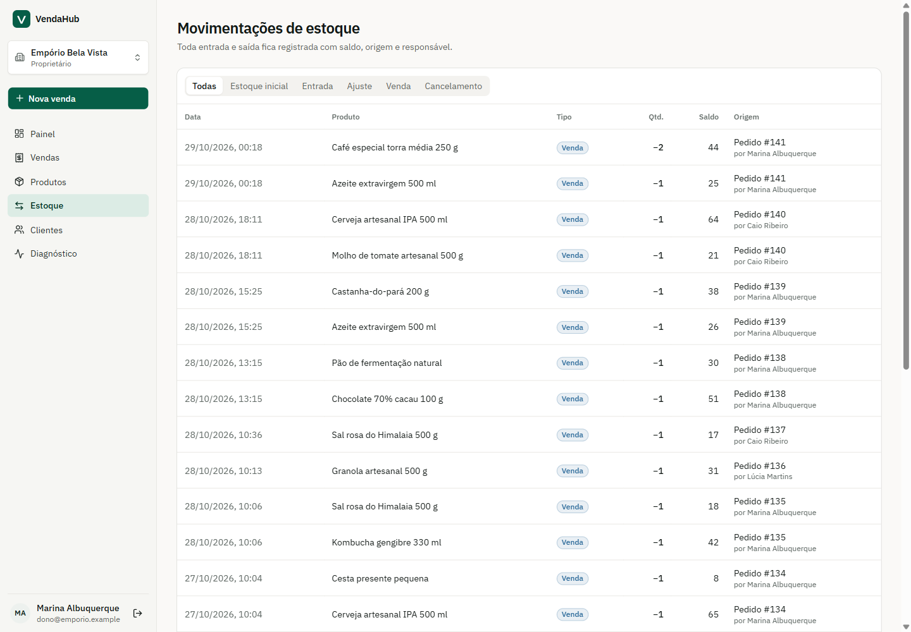 |
| 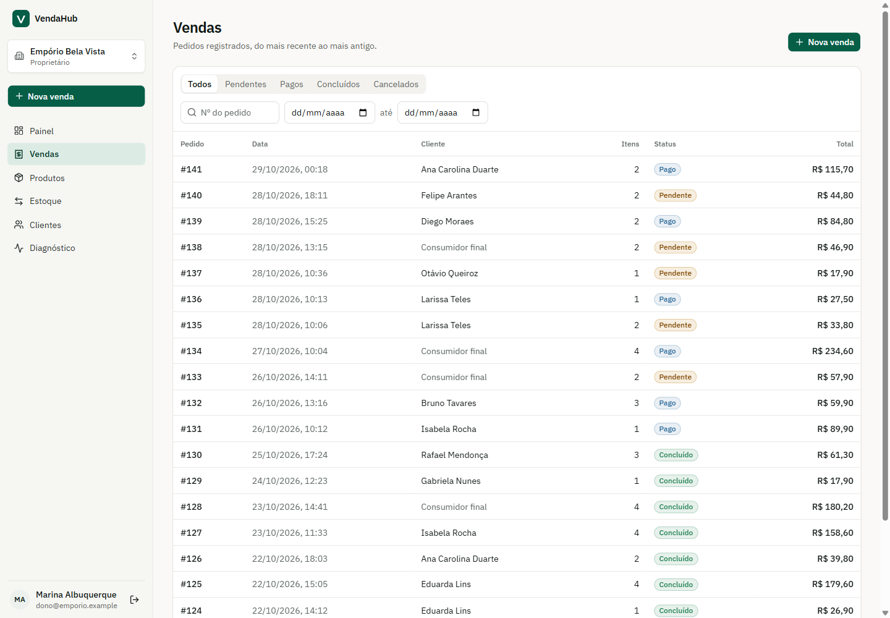 | 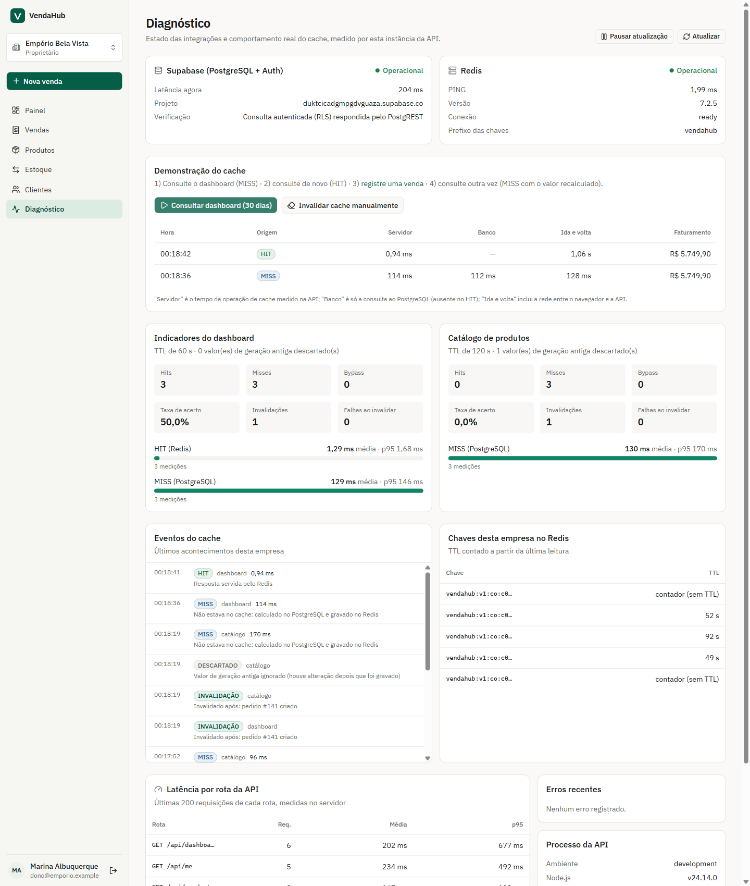 |

No celular (390 px):

<p>
  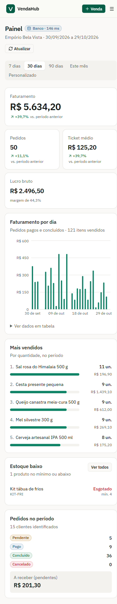
  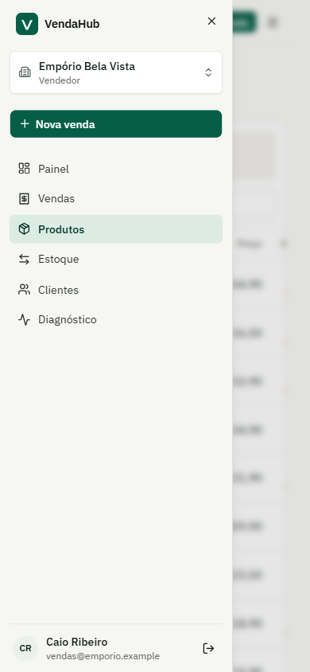
</p>

## Limitações conhecidas

- **Gestão de equipe.** Convidar membros e trocar papéis não tem tela; os vínculos da demonstração são criados pelo seed.
- **Unidades inteiras.** Quantidades em unidades inteiras; não há venda fracionada (kg, litro).
- **Sem financeiro.** Não há pagamento online, nota fiscal, devolução parcial nem formas de pagamento.
- **Ajustes de estoque** não têm chave de idempotência (os pedidos têm).
- **Métricas por processo.** As métricas do diagnóstico ficam na memória da instância da API e zeram ao reiniciá-la. Os valores em cache ficam no Redis.
- **Projeto Supabase pausado.** Projetos no plano gratuito pausam após 7 dias sem uso; reative pelo painel do Supabase antes de uma apresentação.
- **Redis via Docker sem execução registrada.** Os testes registrados acima usaram o Memurai (compatível com Redis). O `docker-compose.yml` está incluído, mas não há execução dele registrada nesses resultados.

LINK DO VÍDEO [https://youtu.be/_mdDclD8E6k?feature=shared]
